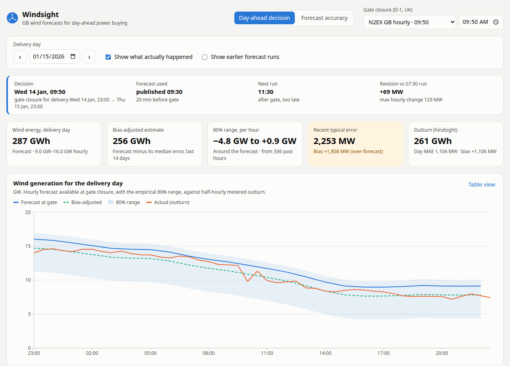

# Windsight

Windsight is a web app for a UK utility's day-ahead power desk. It does two things:

1. **Day-ahead decision view.** For any delivery day, it shows the national wind forecast that was actually available at the day-ahead gate closure on D-1. It also shows a bias-adjusted estimate and an empirical 80% range. Both are built only from errors that were knowable at that moment.
2. **Forecast accuracy view.** It measures how far that forecast missed: MAE, bias, P10/P90, the 95th-percentile error, error by lead time, by hour, by day and by gate time. This lets the desk decide with the error in view.

Scope is limited as the brief asks: national-level **wind only**, from Elexon BMRS (actuals `FUELHH` with `fuelType=WIND`, forecasts `WINDFOR`), for **purchase decisions made in January 2026**.

> **Live demo:** _add the Vercel URL here after deploying (see below)._



## Main findings (January 2026, N2EX 09:50 gate)

| | |
|---|---|
| Forecast used at the gate | the 09:30 run, with lead times of 14–37 h (median 25 h) |
| Mean absolute error | **1,991 MW**, which is 17.6% of mean wind output (11.3 GW) |
| Bias | **+1,727 MW**. The forecast was above outturn on 27 of 31 delivery days |
| 80% of hourly errors | between −0.5 GW and +4.2 GW (forecast − actual) |
| 1-in-20-hour error | 5.3 GW |
| Bias-adjusted estimate (no look-ahead) | MAE **1,553 MW (−22%)** |
| Empirical 80% range, back-tested | contained the outturn **80.9%** of the time |
| Gate timing | 09:20 (EPEX) misses the 09:30 run by 10 minutes: MAE 2,019 vs 1,991 MW |

Even a forecast published 0 h before the target over-forecasts by about 1.5 GW. So most of the gap is **systematic** and does not come from forecast skill. One plausible cause is wind curtailment for transmission constraints: the metered output in FUELHH is net of turn-downs. Checking this needs data beyond the brief's scope (e.g. BOALF/constraint volumes), so it is an assumption here, not a verified explanation.

## Running it

### Docker (one container: API + built React app)

```bash
docker compose up --build
# open http://localhost:8000
```

`DATA_SOURCE=live docker compose up` fetches from Elexon at startup instead of using the bundled snapshot. If Elexon can't be reached, it falls back to the snapshot.

### Local development

```bash
# backend (Python 3.12)
cd backend
python -m venv .venv && .venv/bin/pip install -r requirements.txt -r requirements-dev.txt
.venv/bin/uvicorn app.main:app --reload --port 8000
.venv/bin/python -m pytest            # 11 tests

# frontend (Node 20), in a second terminal; proxies /api to :8000
cd frontend
npm install && npm run dev            # http://localhost:5173
```

To refresh the bundled data from Elexon: `cd backend && .venv/bin/python -m app.store`.

### Deploying

**Vercel (recommended, free tier).** `vercel.json` builds the React app as static files and exposes the FastAPI app as one Python serverless function (`api/index.py`) under `/api/*`.

```bash
npx vercel login
npx vercel --prod
```

**Heroku (container stack).** `heroku.yml` builds the same Dockerfile. The container listens on `$PORT`.

```bash
heroku create <app-name> --stack container
git push heroku main
```

## API

| Endpoint | Purpose |
|---|---|
| `GET /api/meta` | Scope, gate presets, data provenance |
| `GET /api/day?date=2026-01-15&gate=09:50` | Forecast at the gate for that delivery day, plus band, adjusted estimate, earlier runs and actuals |
| `GET /api/accuracy?mode=decision&gate=09:50&start=…&end=…` | Accuracy of the forecast used at the gate |
| `GET /api/accuracy?mode=horizon&horizon=24` | Accuracy of the latest forecast published ≥ H hours before each target |

Interactive docs are at `/docs` when the app runs locally.

## Domain assumptions

- **Delivery day** D runs from 23:00 UK on D-1 to 23:00 UK on D, the GB day-ahead convention. In January, UK time = UTC.
- **Gate closure** defaults to **09:50 UK on D-1** (Nord Pool N2EX GB hourly auction). Presets also cover 09:20 (EPEX GB hourly) and 15:30 (GB half-hourly auction), and any custom time works. The 09:20 EPEX time comes from a secondary source.
- **"Decisions made in January 2026"** means decision dates 1–31 Jan, so delivery days are **2 Jan – 1 Feb**. Data from 15 Dec onwards is also loaded so that early-January error bands have 14 days of history.
- **Forecast at the gate** means, for each delivery hour, the latest WINDFOR run with `publishTime ≤ gate` that covers that hour. A run published exactly at the gate counts.
- **Matching:** WINDFOR is hourly and FUELHH half-hourly. Errors are scored at each hourly target against the settlement period starting at that time. Charts show the full half-hourly outturn.
- **Error sign:** error = forecast − actual. A positive error means less wind arrived than forecast, and the shortfall had to be bought later.

See [docs/DESIGN.md](docs/DESIGN.md) for the technical design and [docs/PITCH.md](docs/PITCH.md) for the client pitch.

## Use of AI tools

This project was built with help from an AI coding assistant (Claude Code, Anthropic). It was used for:

- researching the GB day-ahead auction timings
- profiling the Elexon datasets
- scaffolding and writing the backend, frontend, tests and deployment configuration
- drafting the docs

I reviewed the analysis choices and checked the numbers in this README against the running app.
